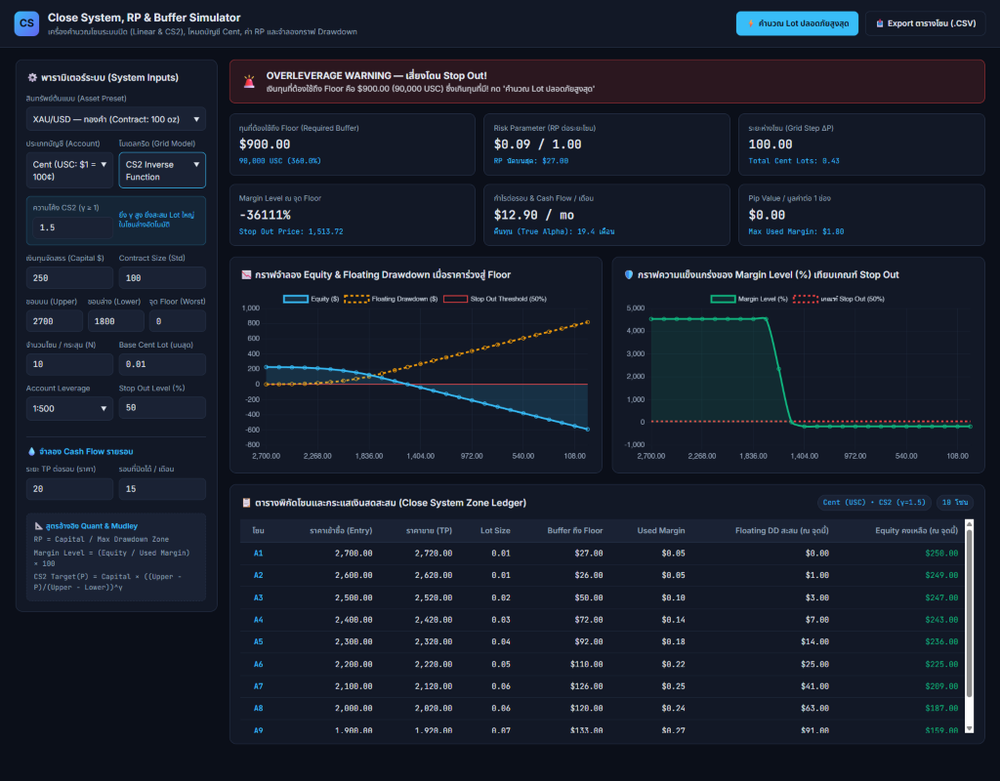

<div align="center">

# 📊 Close System, RP & Buffer Simulator

**เว็บแอปพลิเคชันคำนวณโซนระบบปิด (Close System / KZM), ค่า Risk Parameter (RP), เงินสำรอง Buffer และจำลองกราฟ Drawdown เชิงปริมาณ**

[](https://developer.mozilla.org/en-US/docs/Web/HTML)
[](https://developer.mozilla.org/en-US/docs/Web/JavaScript)
[](https://www.chartjs.org/)
[](LICENSE)

</div>

---

## 🖥️ Preview



---

## 🎯 Overview (ภาพรวมโปรเจกต์)

**Close System, RP & Buffer Simulator** ถูกออกแบบมาเพื่อช่วยเทรดเดอร์สาย **Quantitative Finance** และผู้ประยุกต์ใช้ **Mudley Framework (Close System / KZM)** ในการคำนวณโครงสร้างหน้าตักก่อนเข้าเทรดจริง เพื่อลดความเสี่ยงจากการ **Overleverage** และป้องกันการเกิด **Stop Out** ภายใต้สภาวะตลาดผันผวน

### ✨ Key Features (ฟีเจอร์หลัก)
- **⚡ Real-Time Risk & Buffer Engine:** คำนวณทุนสำรองที่ต้องใช้ถึงจุด `Floor`, ค่า `Risk Parameter (RP)`, `Margin Level (%)` และ `Stop Out Price` ทันทีที่ปรับพารามิเตอร์
- **🪙 Standard & Cent Account Mode:** รองรับทั้งบัญชี **Standard (USD)** และบัญชี **Cent (USC: $1 = 100¢)** โดยปรับขนาด `Effective Contract Size` ให้อัตโนมัติ
- **📐 Linear Grid & CS2 Inverse Function:** เลือกได้ทั้งการวางโซนแบบ Lot คงที่ (**Linear Grid**) และฟังก์ชันแปรผกผัน (**CS2 Inverse Function**) ที่เพิ่มขนาด Lot อัตโนมัติในโซนราคาต่ำ
- **📉 Interactive Stress-Test Charts:** จำลองกราฟ **Equity vs. Floating Drawdown** และ **Margin Level (%)** เทียบกับเส้นเกณฑ์ Stop Out ของโบรกเกอร์
- **🛡️ Auto-Safe Lot Calculator:** ปุ่มคำนวณ Lot Size สูงสุดที่ปลอดภัยไม่ให้โดน Stop Out จนถึงระดับ `Floor` ที่กำหนด
- **📥 Excel-Ready CSV Export:** ส่งออกตารางพิกัดโซน (`A1..AN`) พร้อมราคา Entry, TP, Buffer และ Floating DD สะสมเป็นไฟล์ `.CSV`

---

## 🧮 Quantitative Formulas (สมการที่ใช้คำนวณ)

1. **Risk Parameter (RP) & Full-Reserve Buffer:**
   $$RP_{Zone} = \frac{Capital\ Allocated}{Max\ Drawdown\ Zone}, \qquad Buffer_i = (P_{Entry, i} - P_{Floor}) \times Contract\ Size \times Lot\ Size_i$$

2. **Margin Level (%) & Stop Out Guard:**
   $$Margin\ Level = \left(\frac{Equity}{Used\ Margin}\right) \times 100$$

3. **Pip Value Calculation (Fixed Quote vs. USD Base Dynamic):**
   $$Pip\ Value = Lot\ Size \times Contract\ Size \times One\ Pip$$

4. **CS2 Inverse Investment Allocation:**
   $$Target(P) = Capital \times \left(\frac{P_{Upper} - P}{P_{Upper} - P_{Lower}}\right)^{\gamma}, \quad \gamma \ge 1$$

---

## 🚀 Quick Start (วิธีติดตั้งและใช้งาน)

โปรเจกต์นี้ทำงานบน **Pure HTML5 / CSS3 / Vanilla JavaScript** (Zero Build Step) สามารถเปิดใช้งานได้ทันที 2 วิธี:

### วิธีที่ 1: เปิดใช้งานทันที (ไม่ต้องติดตั้งอะไรเพิ่ม)
1. ดาวน์โหลดหรือ Clone Repository นี้:
   ```bash
   git clone https://github.com/Ive-Rei/CloseSystem_Calculator.git
   ```
2. เปิดโฟลเดอร์ `CloseSystem_Calculator` แล้วดับเบิลคลิกไฟล์ **`index.html`** เพื่อใช้งานในเบราว์เซอร์ได้ทันที

### วิธีที่ 2: รันผ่าน Local Web Server (ด้วย Python)
```powershell
cd CloseSystem_Calculator
python -m http.server 8080
```
จากนั้นเปิดเบราว์เซอร์ไปที่ `http://localhost:8080`

---

## 📂 Project Structure (โครงสร้างไฟล์)

```text
CloseSystem_Calculator/
├── assets/
│   └── preview.png      # ภาพตัวอย่างหน้าจอแอปพลิเคชัน
├── index.html           # โครงสร้างหลักของหน้าเว็บ
├── style.css            # ธีม Dark Quant UI
├── app.js               # เครื่องคำนวณ Close System, Cent Mode, CS2 และกราฟ Chart.js
├── LICENSE              # สัญญาอนุญาต MIT License
├── .gitignore           # รายการไฟล์ที่ยกเว้นการอัปโหลด
└── README.md            # เอกสารแนะนำการใช้งาน
```

---

## ⚠️ Disclaimer
ซอฟต์แวร์นี้จัดทำขึ้นเพื่อเป็นเครื่องมือคำนวณและจำลองความเสี่ยงทางการเงินเพื่อการศึกษาเท่านั้น ไม่ใช่คำแนะนำในการลงทุน ผู้ใช้งานควรตรวจสอบ `Contract Size`, `Swap` และ `Stop Out Level` ของโบรกเกอร์ที่ใช้จริงก่อนส่งคำสั่งซื้อขายทุกครั้ง
